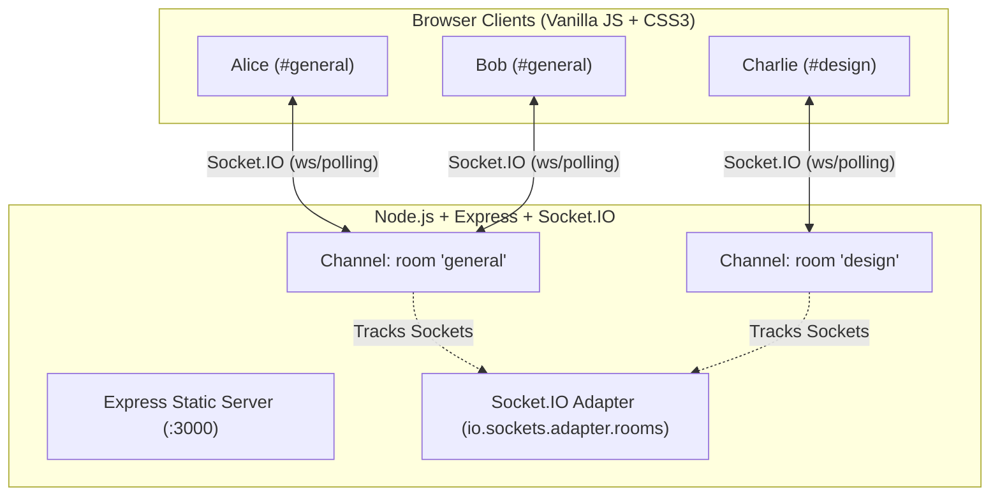

# Multiplayer Real-Time Chat with Rooms

A lightweight, high-performance real-time chat application built with **Node.js**, **Express**, and **Socket.IO**. Users can create or join isolated rooms by name, chat in real-time, see live active user counts, view debounced typing indicators, and receive synthesized audio notifications.

---

## Features

- **Strict Room Isolation**: Messages and typing events broadcast strictly to sockets joined to the specific room (`io.to(room).emit`). No cross-room data leakage.
- **Dynamic Presence & Room Roster**: Uses Socket.IO's native adapter map (`io.sockets.adapter.rooms`) to reliably track active online participants without stale state or memory leaks.
- **Single-Page Architecture**: Smooth animated transition between the Lobby and Chat view without full page reloads.
- **12-Hour Server Timestamps**: Server-synchronized timestamps formatted as `04:15 PM` attached to every message bubble.
- **Live Debounced Typing Indicators**: Displays an animated "Someone is typing..." indicator with bouncing CSS dots, debounced by 1,200ms to eliminate socket flooding.
- **Zero-Dependency Web Audio Chimes**: Synthesizes a gentle two-tone harmonic ping (`E5` 659Hz &rarr; `A5` 880Hz) natively via the browser's `AudioContext` on incoming messages (no external audio assets required).
- **Mute / Unmute Control**: One-click audio toggle (`🔔` / `🔕`) in the chat header.
- **XSS Protection**: Complete DOM-level HTML escaping for all user inputs before rendering into the DOM.
- **Automated Integration Tests**: Full integration test suite using `socket.io-client` testing room isolation programmatically.

---

## Architecture Overview



---

## Quick Start

### Prerequisites
- [Node.js](https://nodejs.org/) (v18.0.0 or higher recommended)
- `npm` (bundled with Node.js)

### 1. Installation
Clone the repository and install dependencies:
```bash
git clone <repo-url>
cd perfecter-ai
npm install
```

### 2. Run the Application
Start the chat server:
```bash
npm start
```
The application will be live at:
**[http://localhost:3000](http://localhost:3000)**

*(For hot-reloading during development, run: `npm run dev`)*

---

## Multi-Tab Demonstration Guide (Verifying Room Isolations)

To experience real-time multiplayer chat and verify that room isolation works as intended:

1. Open **Tab 1**: Navigate to `http://localhost:3000`.
   - Name: `Alice`
   - Room: `general` (or click `#general`)
   - Click **Enter Room**.

2. Open **Tab 2** (side-by-side with Tab 1): Navigate to `http://localhost:3000`.
   - Name: `Bob`
   - Room: `general`
   - Click **Enter Room**.
   - Notice: Alice sees `Bob has joined the room.` Both headers show `2 users online`.

3. Open **Tab 3** (separate room): Navigate to `http://localhost:3000`.
   - Name: `Charlie`
   - Room: `design`
   - Click **Enter Room**.
   - Notice: Charlie's header shows `1 user online`. Alice and Bob remain at `2 users online`.

4. **Verify Message Isolation**:
   - Send a message from Alice in Tab 1: `"Hello general team!"`.
   - Result: Bob (Tab 2) receives the message with a pleasant audio chime.
   - Result: Charlie (Tab 3) receives **nothing**, proving strict room isolation.

5. **Verify Typing Indicators**:
   - Start typing in Alice's input box without pressing Enter.
   - Result: Bob's screen displays `Alice is typing...` with bouncing dots.
   - Result: Charlie's screen displays nothing.

6. **Verify Room Switching & Departure**:
   - In Tab 2, click **Leave**.
   - Result: Alice's room updates to `1 user online` and announces `Bob has left the chat.`

---

## Automated Integration Testing

Run the automated test suite with:
```bash
npm test
```

### What the test verifies:
- Spins up an isolated test server on port `3001`.
- Concurrently connects three test sockets (`Alice` in `#general`, `Bob` in `#general`, and `Charlie` in `#design`).
- Asserts that messages emitted by Alice are received by Bob.
- Asserts that Charlie in `#design` never receives messages or typing alerts from `#general`.
- Validates 12-hour server timestamp attachment.
- Shuts down the sockets and server cleanly with exit code `0`.

---

## Project Structure

```
perfecter-ai/
├── package.json          # Dependencies (express, socket.io, socket.io-client)
├── .gitignore            # Git exclusion rules
├── server.js             # Express server, Socket.IO room events & presence
├── test-rooms.js         # Automated multi-client room isolation test suite
├── README.md             # Project documentation and quick start guide
├── PROMPTS.md            # AI interaction and engineering prompt log
│
└── public/
    ├── index.html        # Clean semantic markup (Lobby & Chat views)
    ├── style.css         # Modern responsive styling, custom CSS variables
    └── app.js            # Client-side controller, Web Audio chime & typing logic
```

---

## License
MIT
